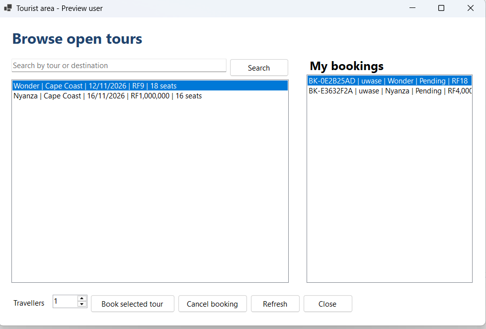
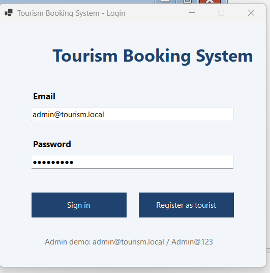
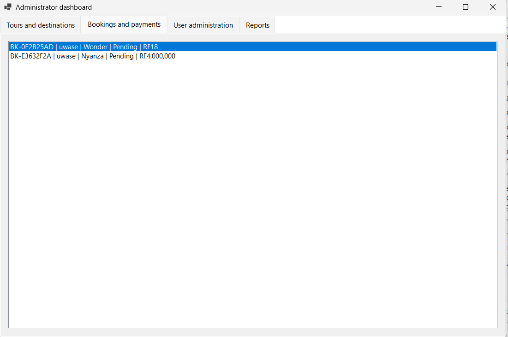
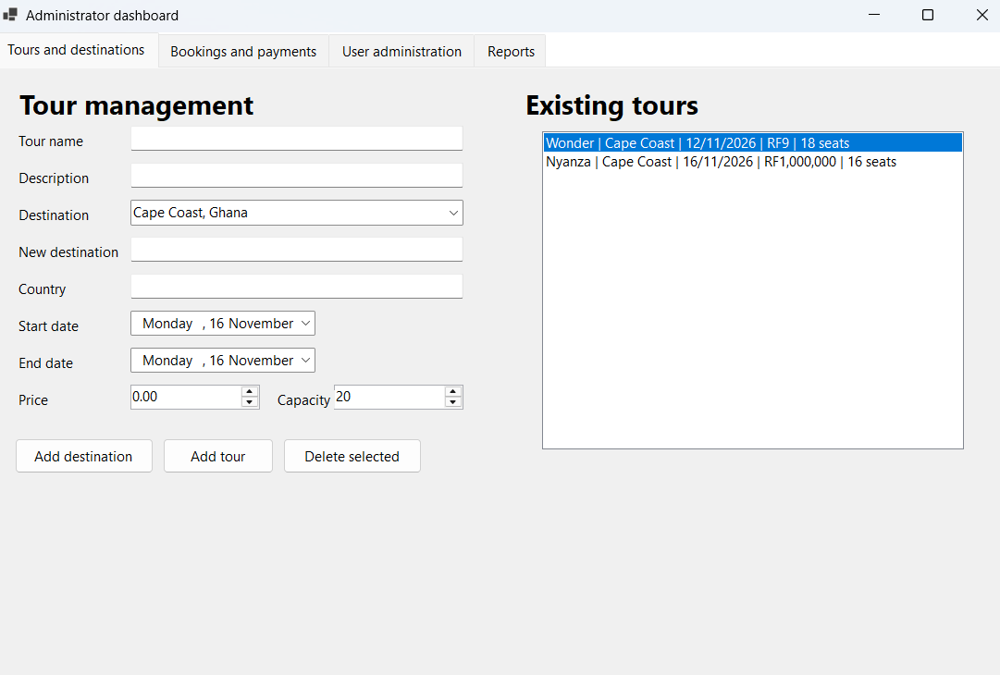
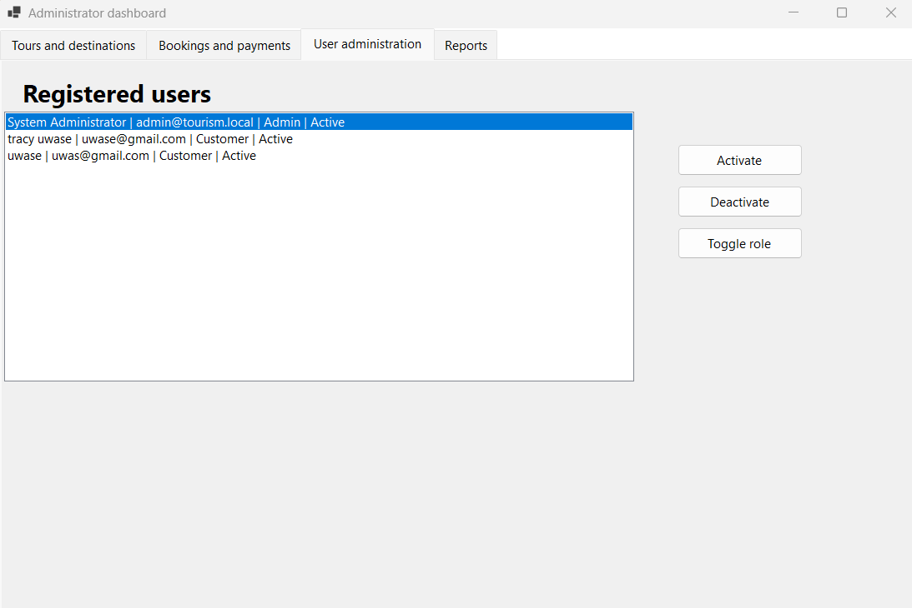
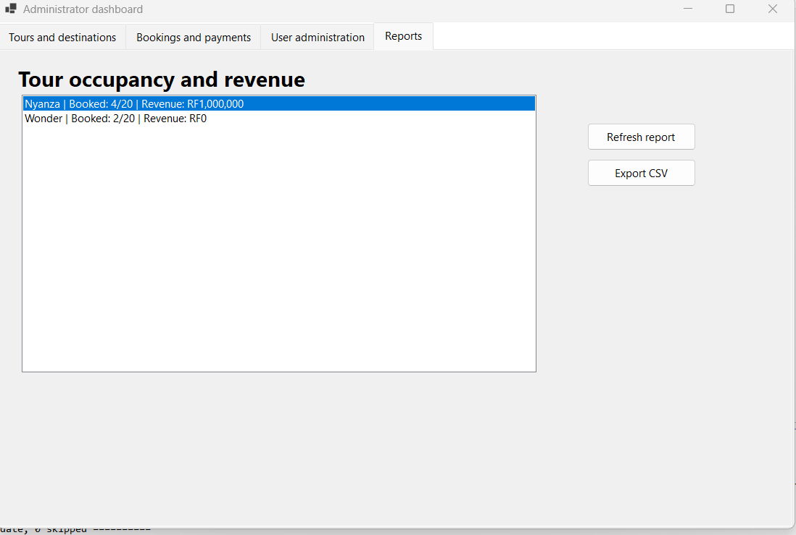
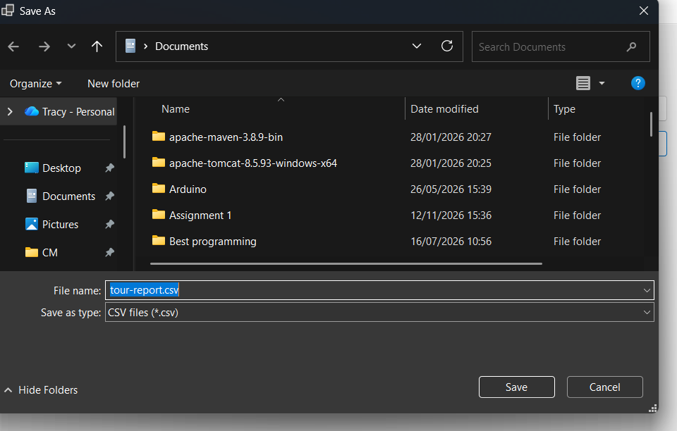

# Lab3

## Tourism Booking System

A .NET 10 Windows Forms application for managing tourism destinations, tours, bookings, payments, users, and reports.

## Screenshots

### 1. Login

### 2. Tourist registration

### 3. Admin tour management

### 4. Bookings and payments

### 5. User administration

### 6. Reports

### 7. Tourist booking area
